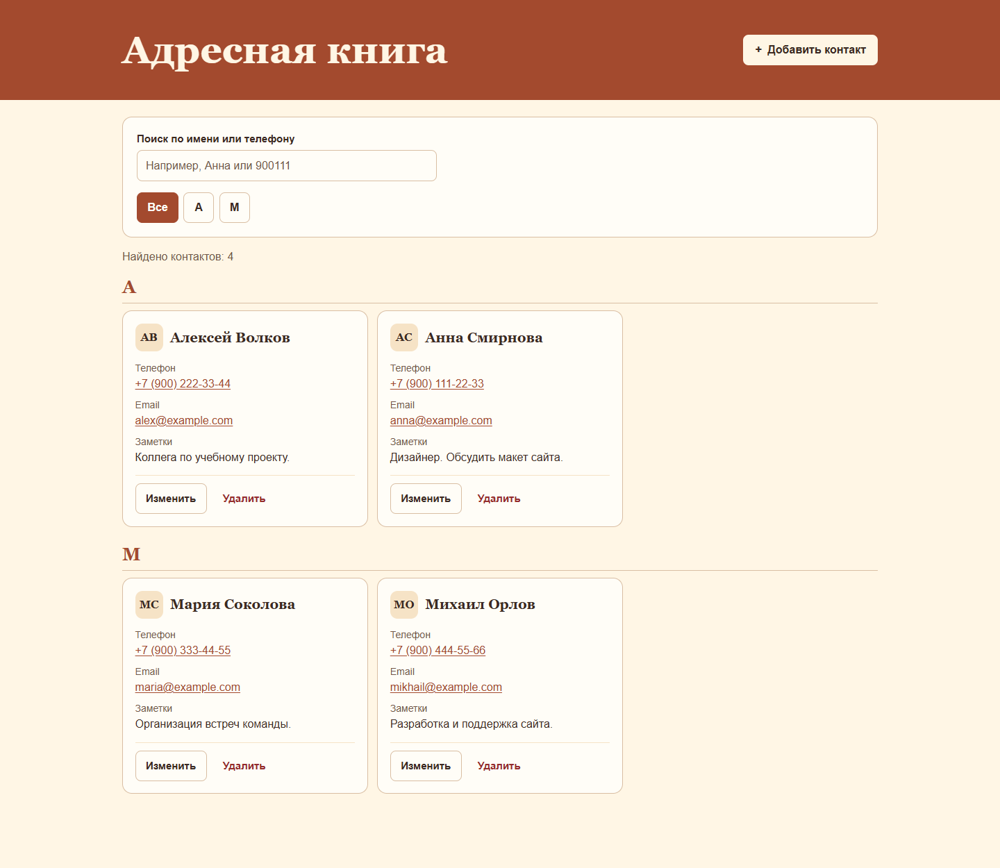
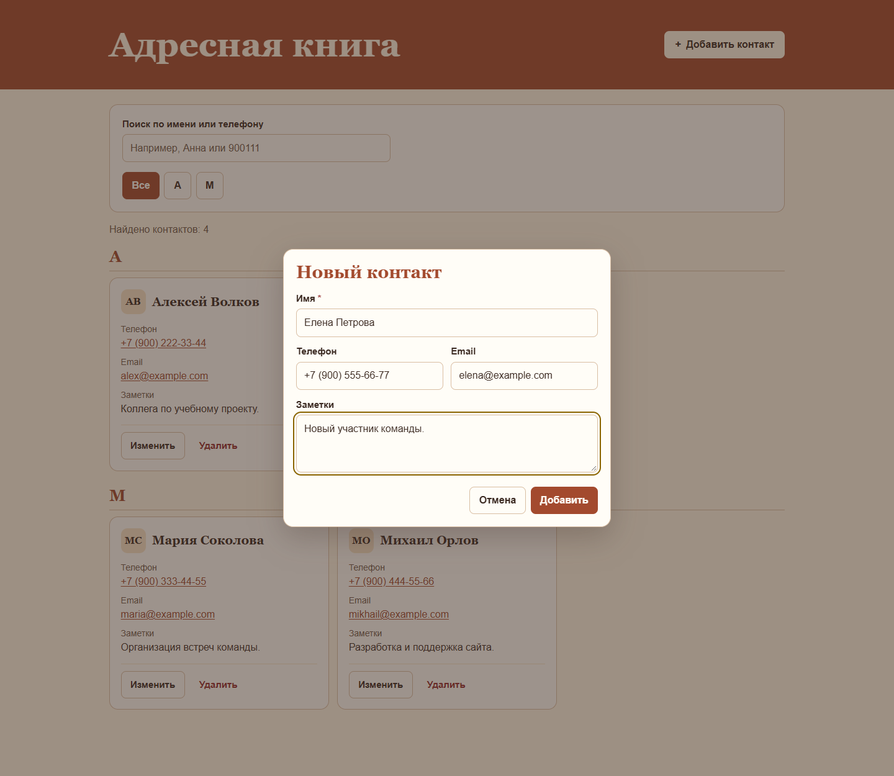
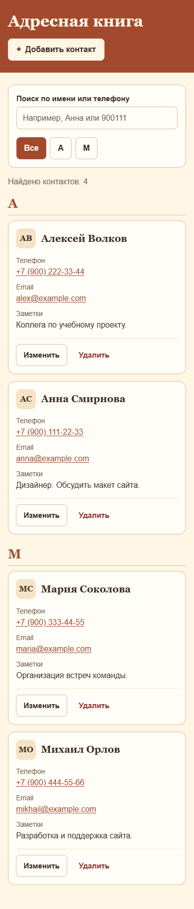
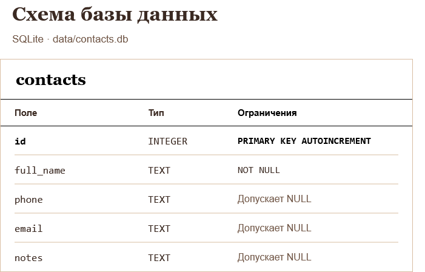

# Адресная книга

Лабораторная работа № 8, вариант 8. Веб-справочник для личных контактов и небольших команд. В карточке можно сохранить имя, телефон, email и заметки.

- Добавление, просмотр, редактирование и удаление контактов.
- Поиск по имени без учёта регистра и по номеру с любым оформлением пробелов, дефисов и скобок.
- Группировка по первой букве, алфавитный указатель для кириллицы и латиницы и пагинация.
- Адаптивная сетка карточек и модальный диалог с проверкой полей.

## Скриншоты

Главная страница: список контактов с группировкой по первой букве, поиском и алфавитным указателем.



Форма добавления контакта с полями имени, телефона, email и заметок.



Мобильная версия: карточки располагаются в одну колонку.



На скриншотах используются вымышленные демонстрационные контакты.

## Запуск

Нужен Node.js 22 или новее. В папке `lab_8` выполните:

```bash
npm ci
npm start
```

Откройте [http://127.0.0.1:3002](http://127.0.0.1:3002). При первом запуске создаётся пустая база `data/contacts.db`. Добавьте первый контакт кнопкой в шапке. Записи сохраняются после перезапуска. Для разработки `npm run dev` перезапускает сервер при изменении серверных файлов.

## Схема базы

| Колонка `contacts` | Тип | Назначение |
| --- | --- | --- |
| `id` | `INTEGER PRIMARY KEY AUTOINCREMENT` | Идентификатор |
| `full_name` | `TEXT NOT NULL` | Имя контакта |
| `phone` | `TEXT` | Телефон |
| `email` | `TEXT` | Email |
| `notes` | `TEXT` | Заметки |

SQLite создаёт таблицу при запуске. Express обслуживает API и статические HTML, CSS и JavaScript.



## API

| Метод и путь | Ответ |
| --- | --- |
| `GET /api/contacts` | `200` — список, фильтры и пагинация |
| `GET /api/contacts/:id` | `200` — контакт |
| `POST /api/contacts` | `201` — созданный контакт |
| `PUT /api/contacts/:id` | `200` — контакт после замены редактируемых полей |
| `DELETE /api/contacts/:id` | `204` — контакт удалён |

Параметры списка `q`, `letter`, `page` и `limit` необязательны. По умолчанию выдаётся первая страница по 10 записей. Допустимый `limit` — от 1 до 100. `letter` принимает одну букву из русского или латинского алфавита либо `%23` для группы `#`.

Ответ списка содержит `data`, `total`, `page`, `limit`, `totalPages` и `letters`. В `data` поле `initial` обозначает группу контакта. `letters` содержит все группы, которые подходят под поисковый запрос, а `total` дополнительно учитывает фильтр по букве.

`POST` и `PUT` принимают JSON с обязательным `full_name` и необязательными `phone`, `email` и `notes`. Пропущенные или пустые необязательные поля получают значение `null`. Неверные параметры или поля дают `400`, отсутствующий контакт — `404`. Примеры запросов приведены в [test.http](test.http).

## Проверка

Проверьте добавление, редактирование, отмену и удаление записи, поиск по номеру без разделителей и смену букв с активным поиском. На узком экране карточки должны занимать одну колонку. В диалоге можно работать с клавиатуры, а после закрытия фокус возвращается к кнопке открытия, если она ещё доступна.

Параметры SQL-запросов передаются отдельно от текста запроса. Текст полей карточки вставляется через `textContent`. Поиск ждёт короткую паузу после ввода, и новый запрос отменяет предыдущий. Формирование списка читает все контакты в память, поэтому рассчитано на небольшой справочник.
